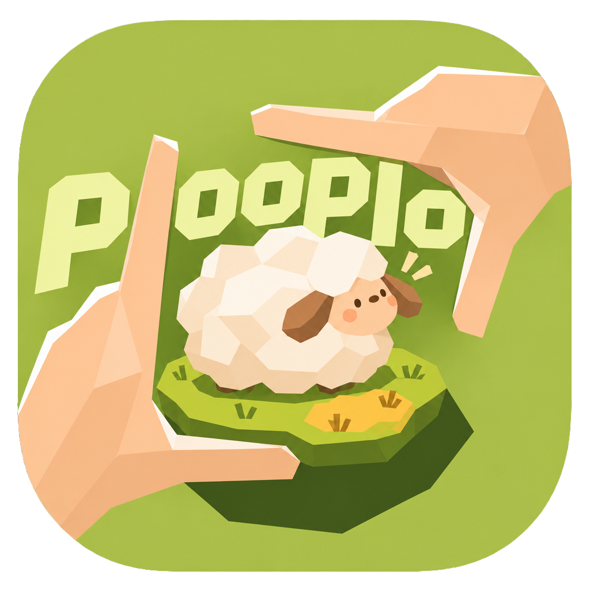
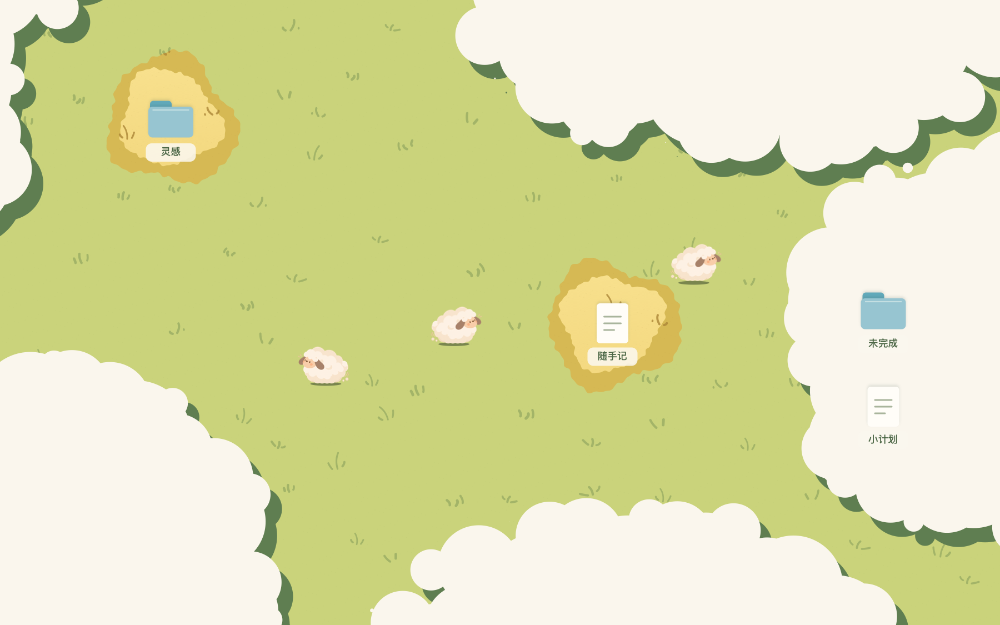

# Pooplo

让桌面变成一个会回应你的小世界。Pooplo 是 macOS 动态壁纸应用，目前提供插画草地主题，未来计划扩展更多主题。

**[下载 macOS 安装包（DMG）](https://github.com/JAigors0503/pooplo/releases/download/v0.2.0-alpha.1/Pooplo-v0.2.0-alpha.1-macOS-arm64.dmg)** · [安装与使用](INSTALL.md) · [更新记录](CHANGELOG.md)

双击下载的 DMG，将左侧 Pooplo 沿箭头拖到右侧 Applications（应用程序），复制完成后从“应用程序”打开。

适用于 **Apple Silicon（M 系列）Mac、macOS 13 或更新版本**。Intel Mac 和 Windows 暂不支持。本版为未公证的内测包，首次打开可能被 macOS 拦截，具体处理方式见安装说明。

## 有什么好玩的

- 文件或文件夹移动并放稳后，附近草地变黄，云朵自然散开。初始图标位置不会触发焦黄。
- 连片黄区在该区域所有文件离开后，才一起慢慢恢复。
- 三只小羊悠闲走动，避开黄区和彼此。
- 云团错开变化；一小时经历白天、日落、夜晚、日出。
- 通过菜单栏暂停、设置登录启动或退出；运行时不占 Dock。

## 怎么退出

点击菜单栏的 Pooplo 入口，选择 **退出 Pooplo**。如果找不到菜单栏入口，再次打开应用，再点击窗口中的 **退出 Pooplo**。再次打开本身不会退出；退出后恢复原壁纸。

## 隐私与当前限制

仅在本机读取 Finder 桌面图标的位置和选择状态，不读取文件名或内容，不移动或修改文件，不上传桌面数据。需要辅助功能权限。

当前只支持主屏；未完成多屏、Intel、长期功耗和其他电脑完整安装验证。登录启动功能已实现，但尚未通过实际注销登录验证。请将此版本视作早期内测版。

本仓库仅用于发布安装包、使用说明和更新记录，不包含应用源码。

问题反馈请在 [Issues](https://github.com/JAigors0503/pooplo/issues) 描述 macOS 版本、芯片类型和复现步骤，避免上传包含私人文件名的桌面截图。
